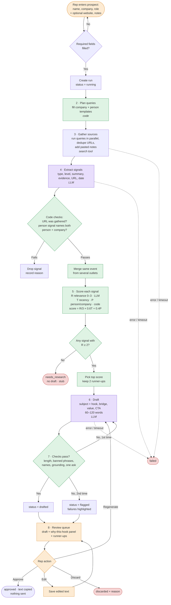
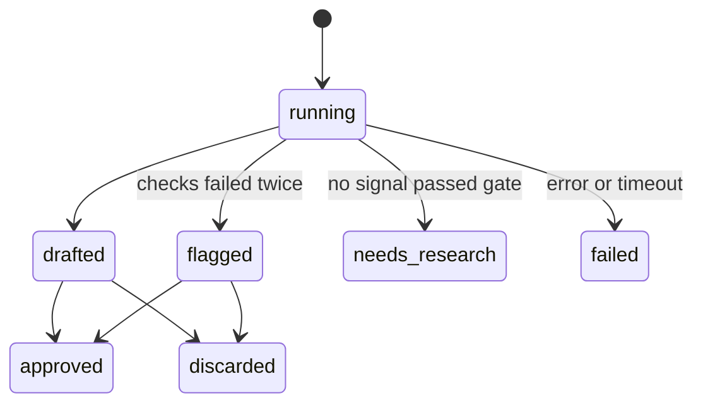

# Outreach Pipeline — Flow Chart

Source: [PLAN.md](PLAN.md). Happy path, plus the two placeholder branches for edge cases.

Colours: purple = LLM, green = code, orange = rep, red = stop states.

## Run states

